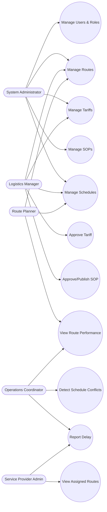

# Use Case Diagram, Use Case Descriptions & User Stories

## 1. Use Case Diagram (textual/Mermaid representation)

Every "Manage" use case implicitly includes Create, Edit, Delete/Archive, and List/Search sub-flows.

---

## 2. Use Case Descriptions

### UC-1: Manage Routes
- **Actors:** Logistics Manager, Route Planner, Administrator
- **Preconditions:** Actor is authenticated with role permitting route management
- **Main Flow:**
  1. Actor opens Route Planner module
  2. Actor creates a route, entering origin, destination, stops, provider
  3. System calculates total distance from stop sequence
  4. Actor saves; system assigns Route ID and status "Active" (default) or "Under Review"
  5. System logs the action to the audit log
- **Alternate Flow:** Actor edits/deletes an existing route (delete only allowed if no active schedules reference it)
- **Postconditions:** Route persisted and available for scheduling and tariff linkage

### UC-2: Manage Tariffs
- **Actors:** Logistics Manager, Administrator
- **Main Flow:**
  1. Actor creates a tariff for a service type + vehicle type + weight/distance range
  2. System computes `Total Freight Cost` preview from base rate, surcharge, additional charges
  3. Actor submits tariff for approval
  4. On any change to an approved tariff, prior version is copied into Tariff History before the update is applied
- **Postconditions:** Tariff moves through Draft → Pending → Approved/Rejected → (later) Archived

### UC-3: Approve Tariff
- **Actor:** Logistics Manager
- **Main Flow:** Reviews a Pending tariff, Approves (status → Approved, effective date activated) or Rejects (status → Rejected, reason logged)

### UC-4: Manage SOPs
- **Actors:** Logistics Manager, Route Planner, Administrator
- **Main Flow:**
  1. Actor drafts an SOP with category and description, attaches documents
  2. On submission, status becomes "Submitted"
  3. Any edit after the SOP is published creates a new version row (version number incremented) rather than overwriting

### UC-5: Approve/Publish SOP
- **Actor:** Logistics Manager
- **Main Flow:** Reviews Submitted SOP → Approves (status → Approved) → Publishes (status → Published, visible to all roles)

### UC-6: Manage Schedules
- **Actors:** Route Planner, Logistics Manager, Administrator
- **Main Flow:**
  1. Actor selects a route and assigns departure/arrival times and a vehicle
  2. System checks for conflicts (same vehicle overlapping time window)
  3. If conflict found, system blocks save and returns conflicting schedule reference
  4. Otherwise schedule is created with status "Scheduled"

### UC-7: Detect Schedule Conflicts
- **Actor:** System (triggered by UC-6)
- **Main Flow:** Compares new schedule's vehicle + time window against existing schedules; returns overlap details if any

### UC-8: Report Delay
- **Actors:** Operations Coordinator, Service Provider Admin
- **Main Flow:** Selects an in-progress schedule, logs delay reason and revised ETA; schedule status changes to "Delayed"

### UC-9: View Route Performance
- **Actors:** Route Planner, Operations Coordinator
- **Main Flow:** Views a route's historical schedules, on-time vs delayed ratio

### UC-10: Manage Users & Roles
- **Actor:** Administrator
- **Main Flow:** Creates users, assigns one of the five roles, deactivates accounts

### UC-11: View Assigned Routes
- **Actor:** Service Provider Admin
- **Main Flow:** Views only routes/schedules where `service_provider_id` matches their own provider record

---

## 3. User Stories

| ID | As a... | I want to... | So that... |
|---|---|---|---|
| US-1 | Route Planner | create a route with multiple stops | I can define exactly how freight travels between two points |
| US-2 | Route Planner | see the total distance auto-calculated | I don't have to compute it manually from stop segments |
| US-3 | Logistics Manager | approve or reject a submitted tariff | only vetted pricing goes live |
| US-4 | Logistics Manager | see the computed total freight cost before approving | I can validate pricing accuracy |
| US-5 | Logistics Manager | see the full history of a tariff's past versions | I can audit pricing changes over time |
| US-6 | Administrator | create an SOP and route it for approval | operational procedures are standardized and vetted |
| US-7 | Logistics Manager | publish an approved SOP | field staff can access the latest official procedure |
| US-8 | Route Planner | search SOPs by category | I can quickly find the procedure relevant to my task |
| US-9 | Route Planner | assign a route and vehicle to a schedule | transit timetables reflect actual operations |
| US-10 | Route Planner | be warned when a schedule conflicts with another | I avoid double-booking a vehicle |
| US-11 | Operations Coordinator | log a delay against a schedule | stakeholders are informed of revised ETAs |
| US-12 | Operations Coordinator | view schedules on a calendar | I can see the day's transit activity at a glance |
| US-13 | Service Provider Admin | see only the routes/schedules assigned to my provider | I'm not overwhelmed with irrelevant data |
| US-14 | Administrator | view an audit log of all changes | I can investigate discrepancies or misuse |
| US-15 | Any authenticated user | log in securely and see only features my role permits | the system stays secure and role-appropriate |
