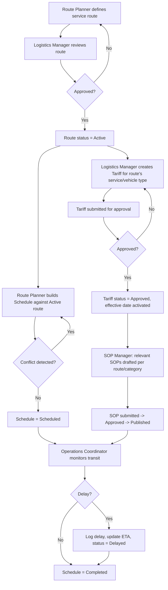
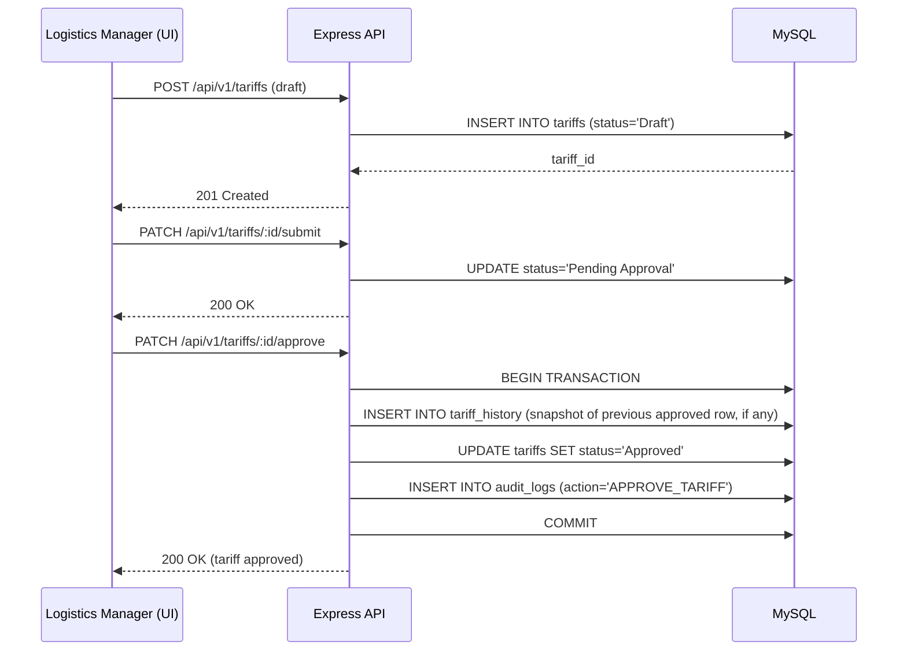
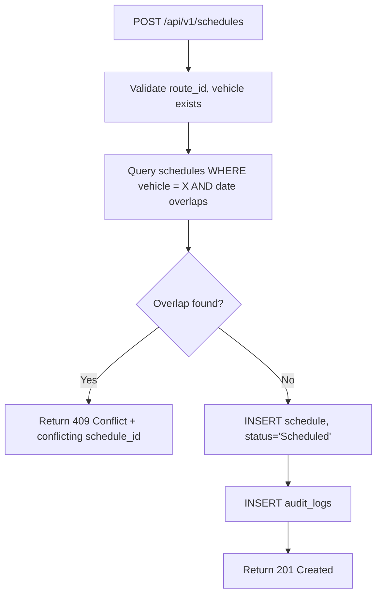
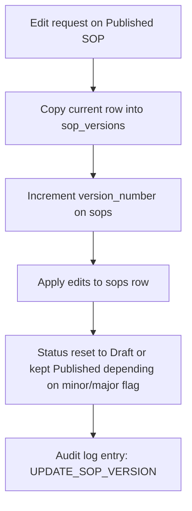

# Business Process Flow & System Workflow

## 1. Business Process Flow — End-to-End

## 2. System Workflow — Tariff Approval (detailed)

## 3. System Workflow — Schedule Conflict Detection

## 4. SOP Version Control Workflow

