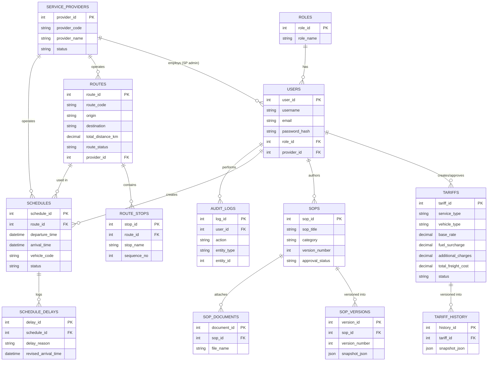

# Database Design — ERD & Schema Notes

## 1. Entity-Relationship Diagram

## 2. Normalization Notes

- All tables are in **3NF**: no repeating groups, no partial dependencies (every non-key column depends on the full primary key), no transitive dependencies.
- `tariffs.total_freight_cost` is a **generated/computed column** (`base_rate + additional_charges + fuel_surcharge`), stored for fast read/filter without risking drift from the formula.
- Historical data (`tariff_history`, `sop_versions`) is stored as **JSON snapshots** rather than duplicating the full column set as a parallel table — this keeps the schema stable even if the parent table gains columns later, at the small cost of losing native SQL filtering on historical field values (acceptable since history is read rarely and sequentially).
- `route_stops` uses a composite uniqueness constraint `(route_id, sequence_no)` to guarantee stop ordering integrity.
- `schedules` indexes `(vehicle_code, departure_time, arrival_time)` specifically to make conflict-detection queries (FR-4.2) fast.

## 3. Standardized IDs for Cross-Module Integration

Every primary entity exposes both:
1. An internal auto-increment `*_id` (INT) — used for FK relationships within Module 9.
2. A human/system-readable `*_code` (e.g. `RT-0001`, `TR-0002`, `SOP-0001`, `SC-0001`) — this is the identifier other modules should reference when linking (e.g., Shipment Management storing `route_code` rather than the raw internal `route_id`), so Module 9's internal numbering can evolve without breaking external references.
